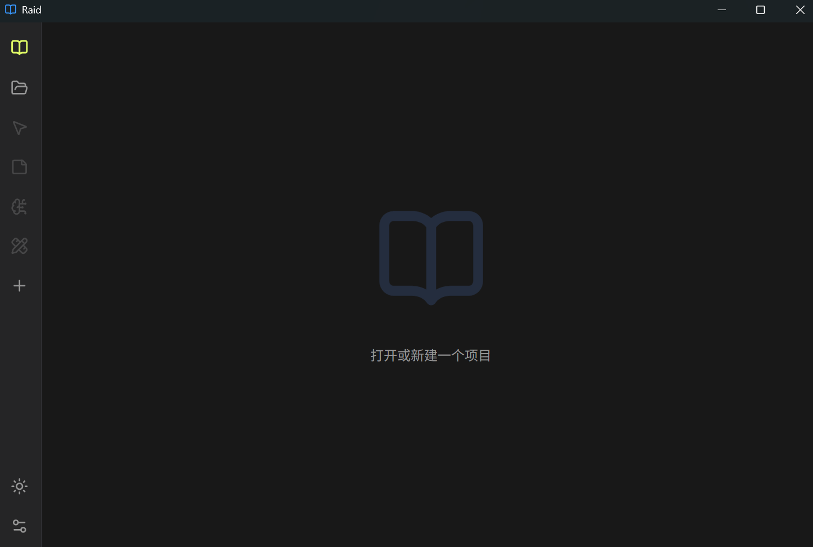
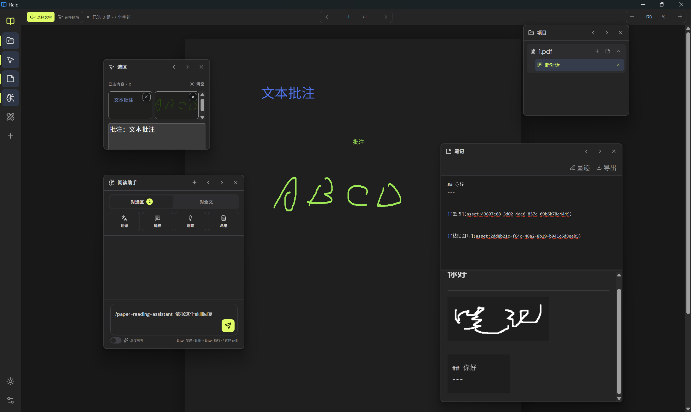
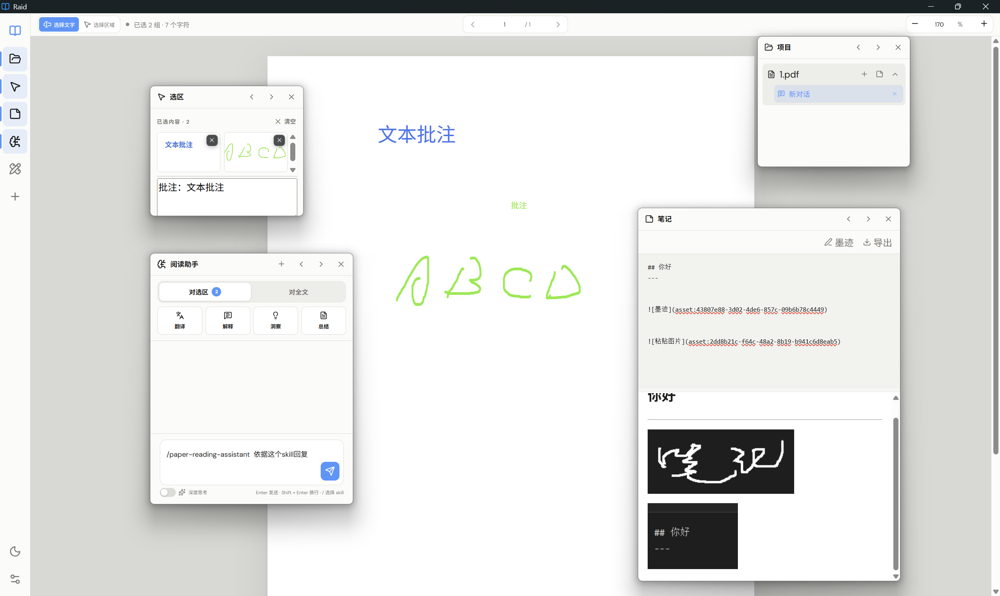

# Raid

[English](README.md) | [简体中文](README_zh-cn.md)

[](LICENSE)


Raid is a lightweight, extensible AI reader for papers, textbooks, and technical documents. It brings multi-file organization, continuous reading, precise selection, OCR, annotations, document tags, retrieval-grounded AI conversations, and user-configured models into one focused desktop workspace.

> Created by **xyLee** · [Repository](https://github.com/lxymol/Reading-Assistant)

## Highlights

- Read PDF, images, plain text, Markdown, source code, EPUB, and common office documents through direct rendering or local PDF conversion
- Import several files together by file picker, drag-and-drop, or clipboard paste
- Keep files ungrouped or arrange them into lightweight, reorderable combinations
- Store conversations beneath their source file and ask AI about a selection, the current document, or the current combination
- Select native text or any number of cross-page visual regions, with OCR and optional vision-model input
- Add colored text highlights, vector ink annotations, and draggable named document tags
- Follow source-linked AI citations back to the exact file, page, and region
- Dock tools on either side or detach them as floating windows
- Use an OpenAI-compatible API or a locally signed-in Codex account, with separate default, vision, and reasoning models
- Import Skills and language packs and enable optional user memory

## Interface preview







## File organization

Raid treats a combination as a simple ordered set of files. Ungrouped files remain in a quiet list beneath all combinations. Files and combinations can be reordered directly, and files can be moved between combinations without reimporting them.

Conversations belong to the file from which they were created and appear beneath that file in the sidebar. A conversation may still use combination context; dissolving a combination moves its files and preserves those conversations instead of deleting them.

## AI context strategy

Raid supplies questions, selections, and documents as normal conversation input, without forcing a paper-tutor persona or a fixed analysis procedure:

- **Selection:** sends the current edited text and visual images when supported. Selection conversation context is included by default. After sending, images move to the user message, where thumbnails can open the original on demand.
- **Document:** supplies the complete readable text. Codex can read the whole attachment rather than only retrieved passages. Text files preserve their original UTF-8 contents; PDF attachments contain extracted text and page numbers. Scans need OCR, and visual selections can supply figures.
- **Combination:** exports each complete document separately for the model to read and compare. Documents are accessed by attachment ID; the renderer does not retain every full index.
- **API mode:** supplies complete text up to 300,000 characters per request. Oversized input produces an explicit error rather than a silently truncated document.
- **Citations:** document mode retains clickable reference locations without limiting the answer to retrieved excerpts.
- **Annotations:** visible ink is composited into visual selections, while relevant text annotations are added to extracted context. Overlapping highlights are normalized so text is not highlighted in duplicate layers.

Selection OCR is an editable aid rather than the only evidence path: when a visual selection is available, Raid can send both its recognized text and original image so the model can verify characters that OCR did not reproduce precisely.

### Codex tools

Raid uses [Codex App Server](https://learn.chatgpt.com/docs/app-server) with persistent conversations and the local Codex default model when no model is specified. Only final answers are displayed; reasoning and interim commentary are hidden. Skills apply only when explicitly selected. Earlier selection images are restored within the request budget, while resumed native threads retain their own multimodal history.

General local commands, arbitrary-path image reads, external MCP servers, and plugin file entry points are disabled. The model reads complete supplied documents through `read_attachment` and `search_attachments`, with about 32 KB per read. Requested output is written through `create_text_file` and imported into the file pane. Temporary attachments and tool routes are removed on completion or cancellation; the Codex child exits after 90 idle seconds. Existing conversations retain their Raid history and migrate to the attachment-tool integration when next used.

Model choice, reasoning settings, tools, and context affect answers. Native conversation integration cannot guarantee identical wording or accuracy to the ChatGPT product.

## Large-document and memory strategy

- PDF pages are rendered after a brief stay near the reading position; pages crossed during rapid scrolling stay as placeholders. Distant pages release canvases and PDF.js page resources.
- The current page and nearby pages receive rendering priority. OCR is deferred until a selection or explicit text need requires it, and the OCR worker exits after an idle period.
- Switching files destroys the previous PDF loading task and revokes temporary object URLs.
- Inactive combinations keep lightweight summaries in memory. Their full file metadata, conversations, and indexes are rehydrated from local storage only when opened.
- Full selection images are stored separately from conversation records; unopened conversations do not load them, and deleting a message, conversation, or its file removes the corresponding images.
- Long conversations initially render the latest 40 messages; older messages load on request, and offscreen thumbnails are released. A visual request is limited to eight images and 12 MB.
- On Windows, software compositing prevents Chromium's GPU process from accumulating PDF page textures during repeated scrolling.

These controls bound normal memory use around the active reading set instead of the total page count or the total size of the library.
`npm run test:memory` opens a 120-page PDF in a hidden desktop window, scrolls through it six times, and checks that the reading process group's working-set sum stays below 500 MB without continued growth. It also checks private committed memory with the Codex child running. Summing working sets counts shared pages repeatedly, so both measures are reported. The threshold is verified for this scenario; real generation, very large files, and other machines need separate measurement.

## Local storage

Versioned records under `RaidData/Data/projects` beside the executable store imported source files, conversations, reading position, highlights, annotations, tags, and local document indexes. Older IndexedDB projects migrate automatically. Deleting a combination from **Settings → Memory → Project memory** permanently removes its stored record and assets.

User memory is a separate, optional, editable profile for stable background and response preferences. Document source text is not learned into that profile.

## Installation

Download the Windows installer from [GitHub Releases](https://github.com/lxymol/Reading-Assistant/releases). Raid does not modify system environment variables and does not require a separate Node.js installation.

Current version: `2.3.0`.

## AI configuration

Open **Settings → Model** and choose either an OpenAI-compatible API or a Codex account already signed in on the computer. API mode uses the configured endpoint and key; Codex mode discovers models from the local Codex sign-in. Both modes stream output as it is generated.

| Configuration | Purpose |
| --- | --- |
| Default model | Text processing, document and combination Q&A, translation, Skill routing, and optional user-memory updates |
| Vision model | Visual selections, formulas, charts, figures, scans, and OCR verification |
| Reasoning model | Text-only reasoning when Deep thinking is enabled |

Advanced configurations inherit the default endpoint and key when left blank. Compatible endpoints should provide `GET /models` and `POST /chat/completions`.

## Skills and language packs

- Import a folder whose root contains `SKILL.md` from **Settings → Skill settings**. Raid reads its instructions and supported text references.
- AI can route automatically from Skill metadata, or a message can begin with `/skill-command` to force a Skill.
- Import a folder containing `language.json` from **Settings → Language settings**. The selected language controls the interface, AI response language, and translation target.

## Run from source

Node.js 20 or later is required.

```bash
npm install
npm run dev
```

Start the isolated desktop test build with:

```bash
npm run desktop:test
```

## Build

```bash
npm run lint
npm test
npm run build
npm run test:memory
npm run desktop:pack
```

The Windows installer is written to `release-2.3.0`.

## Privacy and security

- PDF rendering, extraction, OCR, indexing, annotations, tags, and project storage run locally.
- Data is sent to the configured AI service only after an AI action. The exact material depends on the selected scope described above.
- Imported files and related assets stay under `RaidData/Data/projects` unless their content is included in an AI request.
- API settings remain in the local application data directory and are not included in the repository or installer, but they are not protected by an operating-system credential vault.

See [SECURITY.md](SECURITY.md) for vulnerability reporting guidance.

## Contributing

Issues and pull requests are welcome. Read [CONTRIBUTING.md](CONTRIBUTING.md) before starting development.

## License

Raid is licensed under the [MIT License](LICENSE).
